# Examples

The sample reports of Report Manager, run by the JavaScript engine of the `@reportman/*` packages.
Each picture is the first page of a report; its PDF is what `@reportman/node` makes of it, with the
sample SQLite database and the TrueType fonts of the system. The reports are the same `.rep` files
the Delphi and .NET designers open, and they give the same pages in the three engines.

## Try them

In your browser, with nothing installed: the **[live demo](https://reportman.es/demo/)** runs
every sample on the page itself (the form of its parameters, the preview of its pages and its PDF),
with the same packages.

In a minute on your computer, without writing code:

```bash
npx @reportman/server --samples
```

It installs the samples with their database in `./reportman-data`, prints the console key and
listens on `http://127.0.0.1:8080/`. Open that address, enter the key, and the API explorer runs
each sample to PDF, metafile, text or CSV, showing the same call for curl, PowerShell, JavaScript,
C# and Delphi.

From the command line, with `@reportman/node`:

```bash
npm install @reportman/node
curl -LO https://raw.githubusercontent.com/tonimartir/reportman/main/samples/invoices.rep
curl -LO https://raw.githubusercontent.com/tonimartir/reportman/main/samples/samples.db
npx reportman-pdf invoices.rep --describe --sqlite SAMPLES=samples.db                  # step 1: its parameters
npx reportman-pdf invoices.rep -o invoices.pdf --sqlite SAMPLES=samples.db -paramFIRST_ORDER=7 -paramLAST_ORDER=9
```

`letter.rep` (HTML text) and `international.rep` (eight scripts) need the TrueType fonts of the
system: add `--fonts` (or `--font-folder <folder>`). Which fonts, on Windows, Linux, macOS and in
Docker: [Fonts](../packages/reportman-node/README.md#fonts) in the README of `@reportman/node`.

From a program (ES module; a CommonJS program loads it the same way with `require`):

```js
import { writeFileSync } from 'node:fs';
import { openReport, sqlite } from '@reportman/node';

const report = await openReport('invoices.rep', {
  connections: { SAMPLES: sqlite('samples.db') },
  fonts: {}, // the TrueType fonts of the system; without it, the 14 standard PDF fonts
});
console.log(await report.describeParameters()); // step 1: FIRST_ORDER, LAST_ORDER
writeFileSync('invoices.pdf', await report.executeToPdf({ FIRST_ORDER: 7, LAST_ORDER: 9 })); // step 2
```

Node 22.12 or later (`node:sqlite`, which Node still calls experimental, reads the database). The
sample database and reports are in [`samples/`](../../samples), and `@reportman/server` carries a copy.

## Gallery

<table>
<tr>
<td width="33%" valign="top"><a href="pdf/fishes.pdf">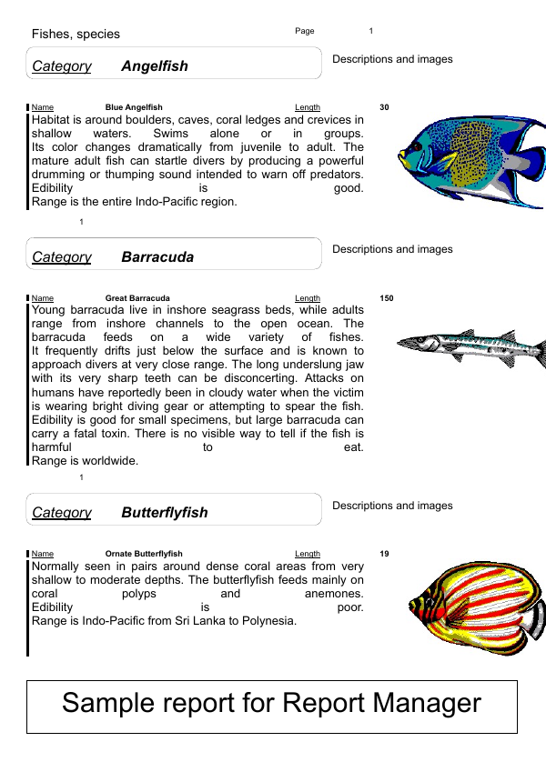</a><br><b>Fishes (classic)</b><br>Groups by category, long notes that flow across pages, pictures stored in the database and a chart.<br><a href="../../samples/fishes.rep">fishes.rep</a> · <a href="pdf/fishes.pdf">PDF</a></td>
<td width="33%" valign="top"><a href="pdf/customers.pdf">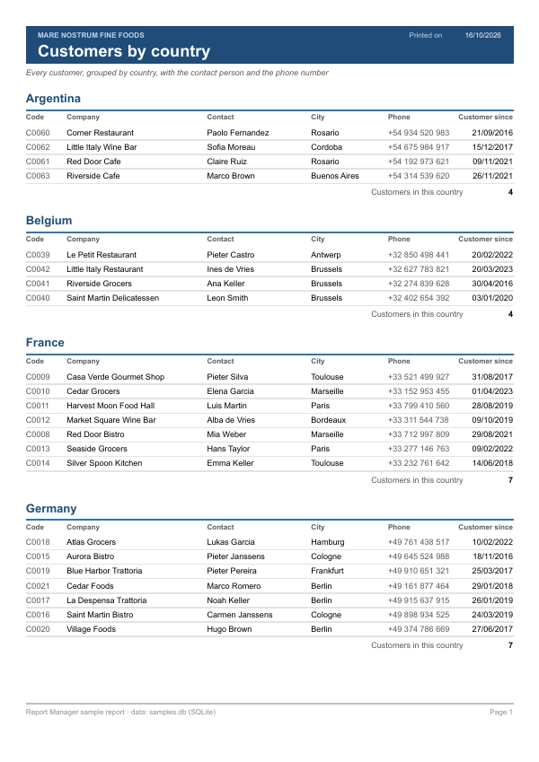</a><br><b>Customers by country</b><br>A list grouped by country, with the column headings repeated on every page, a count per group and the grand total.<br><a href="../../samples/customers.rep">customers.rep</a> · <a href="pdf/customers.pdf">PDF</a></td>
<td width="33%" valign="top"><a href="pdf/invoices.pdf">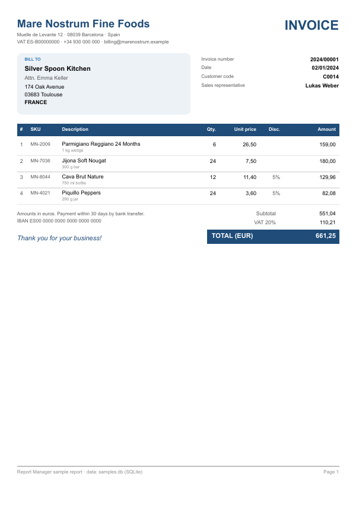</a><br><b>Invoices</b><br>One invoice per page: customer, order lines, discounts, VAT and totals. It asks for the range of orders to print.<br><a href="../../samples/invoices.rep">invoices.rep</a> · <a href="pdf/invoices.pdf">PDF</a></td>
</tr>
<tr>
<td valign="top"><a href="pdf/letter.pdf">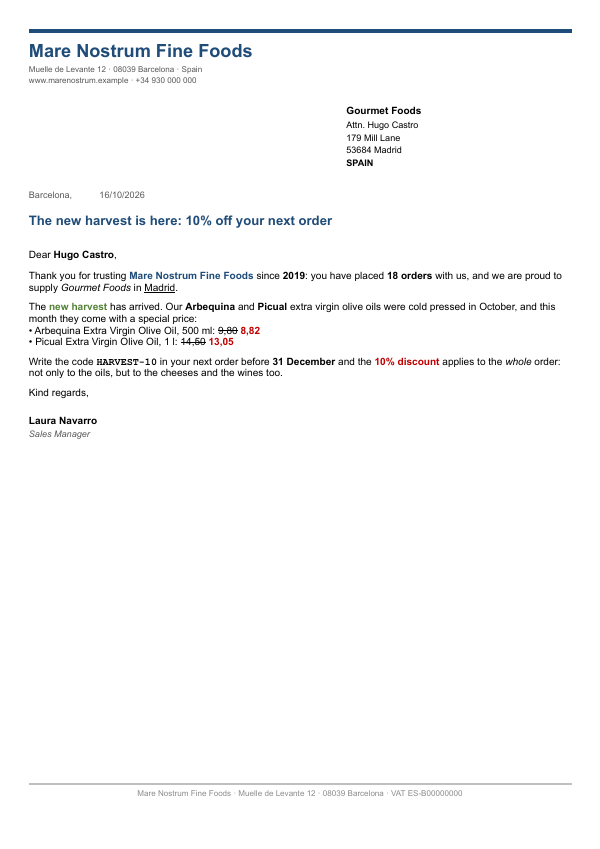</a><br><b>Customer letter (HTML text)</b><br>A personalised letter for each customer: text with HTML marks (bold, italics, underline, colours and another font) in paragraphs that grow with their text.<br><a href="../../samples/letter.rep">letter.rep</a> · <a href="pdf/letter.pdf">PDF</a></td>
<td valign="top"><a href="pdf/sales-by-category.pdf">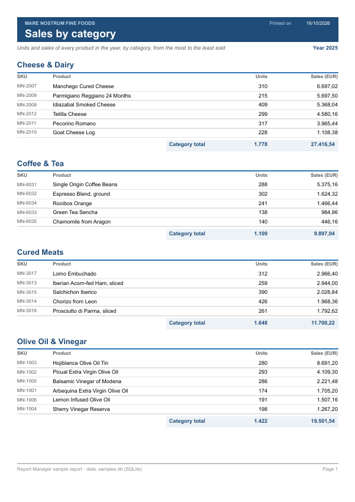</a><br><b>Sales by category</b><br>The sales of a year grouped by category with subtotals, and a summary with a bar chart from a second dataset.<br><a href="../../samples/sales-by-category.rep">sales-by-category.rep</a> · <a href="pdf/sales-by-category.pdf">PDF</a></td>
<td valign="top"><a href="pdf/product-catalog.pdf">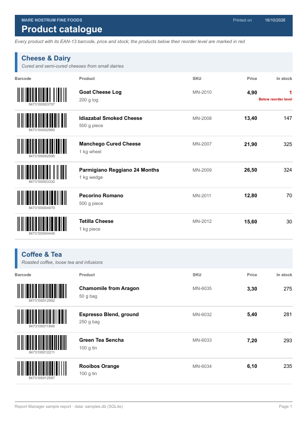</a><br><b>Product catalogue</b><br>Products with EAN-13 barcodes; the stock below the reorder level is highlighted with conditional printing.<br><a href="../../samples/product-catalog.rep">product-catalog.rep</a> · <a href="pdf/product-catalog.pdf">PDF</a></td>
</tr>
<tr>
<td valign="top"><a href="pdf/monthly-sales.pdf">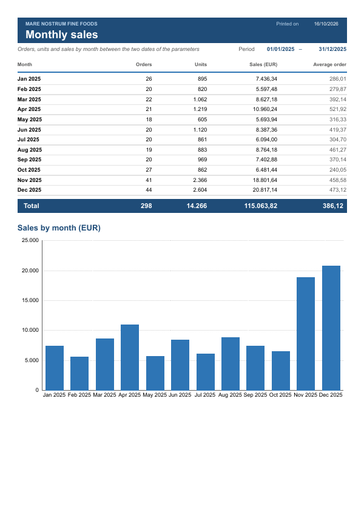</a><br><b>Monthly sales</b><br>Orders and sales by month between two dates given as parameters, with totals, averages and a column chart.<br><a href="../../samples/monthly-sales.rep">monthly-sales.rep</a> · <a href="pdf/monthly-sales.pdf">PDF</a></td>
<td valign="top"><a href="pdf/labels.pdf">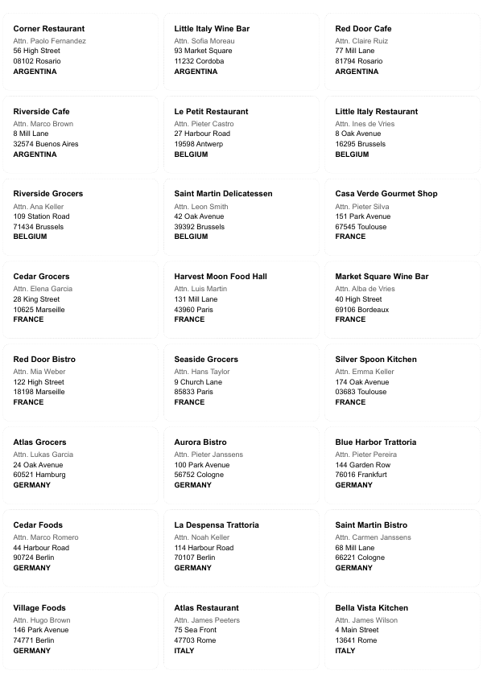</a><br><b>Address labels</b><br>Customer address labels, three per row on A4 sheets (70 x 36 mm), with the horizontal displacement of the detail section.<br><a href="../../samples/labels.rep">labels.rep</a> · <a href="pdf/labels.pdf">PDF</a></td>
<td valign="top"><a href="pdf/international.pdf">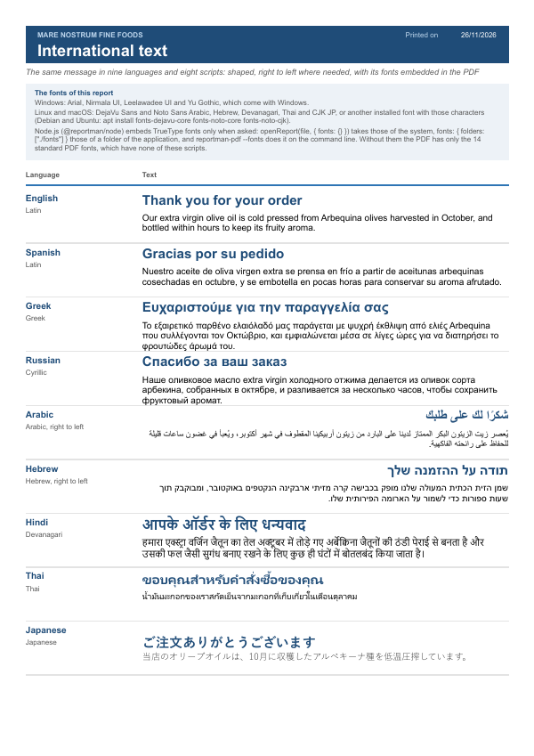</a><br><b>International text</b><br>The same message in nine languages and eight scripts: Arabic and Hebrew from right to left, Devanagari, Thai and Japanese, with the fonts embedded in the PDF.<br><a href="../../samples/international.rep">international.rep</a> · <a href="pdf/international.pdf">PDF</a></td>
</tr>
<tr>
<td valign="top"><a href="pdf/contacts.pdf">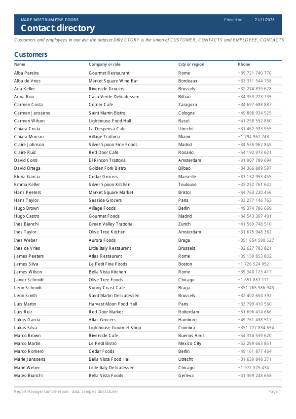</a><br><b>Contact directory (union)</b><br>Customers and employees in one list: an in-memory dataset that joins the rows of two queries, one after the other, grouped by kind of contact.<br><a href="../../samples/contacts.rep">contacts.rep</a> · <a href="pdf/contacts.pdf">PDF</a></td>
<td valign="top"><a href="pdf/year-over-year.pdf">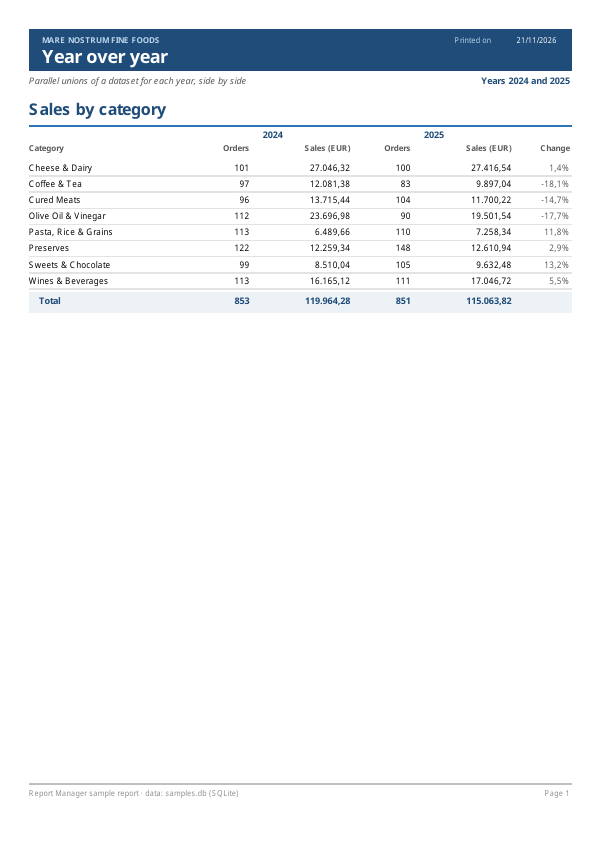</a><br><b>Year over year (parallel union)</b><br>The sales of two years side by side: parallel unions put the columns of two datasets in the same row, matched by category, or by position for the ten best sold products of each year.<br><a href="../../samples/year-over-year.rep">year-over-year.rep</a> · <a href="pdf/year-over-year.pdf">PDF</a></td>
<td></td>
</tr>
</table>

## The PDFs again

```bash
npm run build                    # in typescript/, once
node examples/make-pdfs.mjs      # every sample (or the names given) into examples/pdf
```
