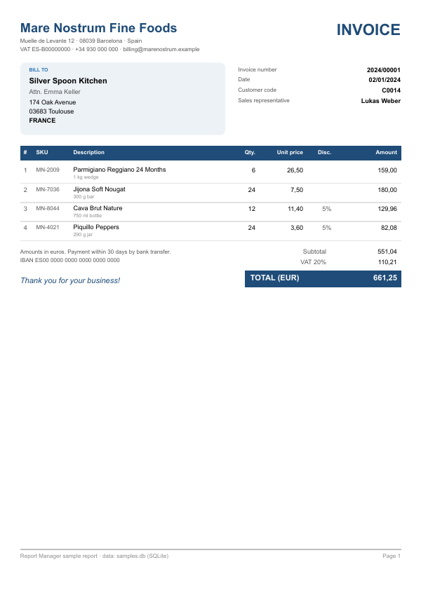
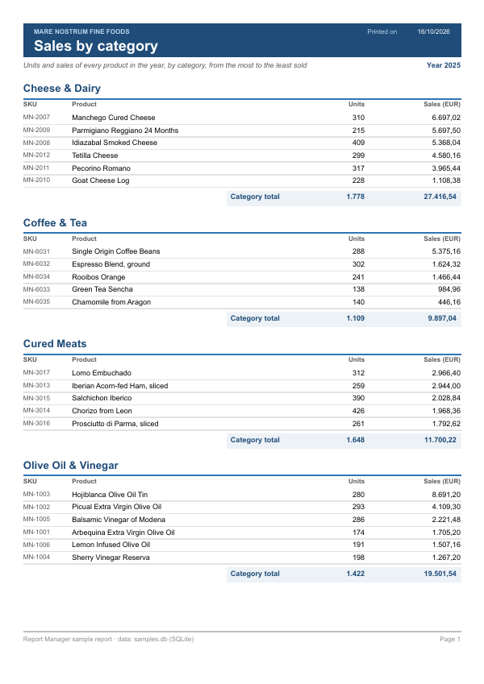
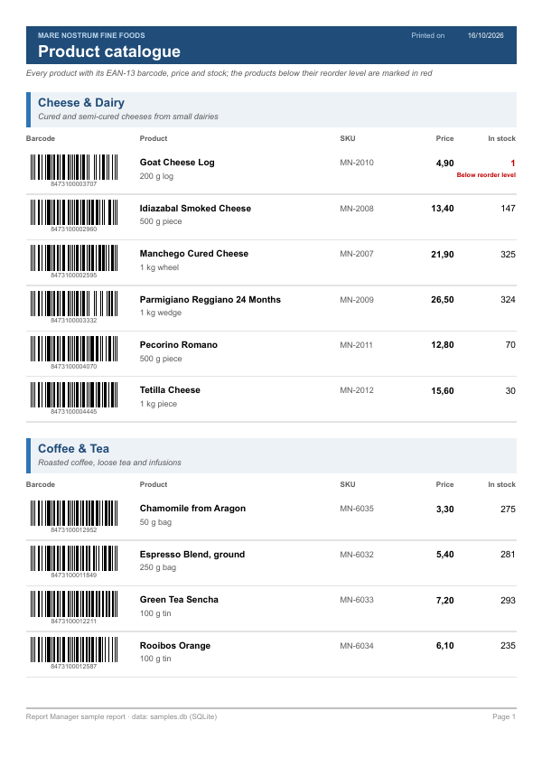
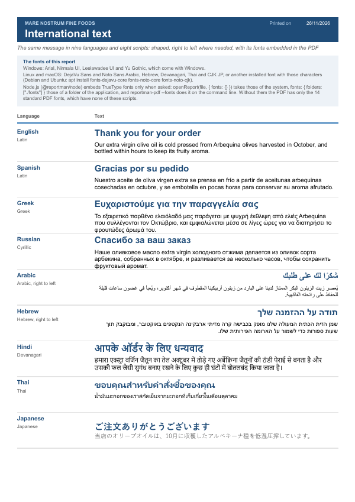

# @reportman/engine

The report engine of Report Manager in JavaScript, a translation of the C# engine: the expression
language (its functions and the .NET number and date formats it relies on), parameters in two
steps, datasets, and the layout of a report into a metafile — sections, groups, subreports, images,
barcodes and charts. It does no I/O: the host gives the report, the data, the fonts and the clock.

Most programs do not use it directly. In Node.js, [`@reportman/node`](https://www.npmjs.com/package/@reportman/node)
opens a `.rep`, describes its parameters and runs it to PDF with this engine;
[`@reportman/server`](https://www.npmjs.com/package/@reportman/server) serves reports over HTTP; in a
browser, [`@reportman/canvas`](https://www.npmjs.com/package/@reportman/canvas) draws the metafile
it lays out.

Status: preview (`4.1.0-alpha.N`): the API may change until 4.1.0. Browser and Node.

## Examples

Eleven sample reports, with pictures of their pages, their `.rep` files and the PDFs
`@reportman/node` makes of them, are in the
[examples gallery](https://github.com/tonimartir/reportman/tree/main/typescript/examples). To see
them run: `npx @reportman/server --samples`.

## The packages

The engine and the packages around it are described in the
[TypeScript README](https://github.com/tonimartir/reportman/tree/main/typescript) of the repository.
