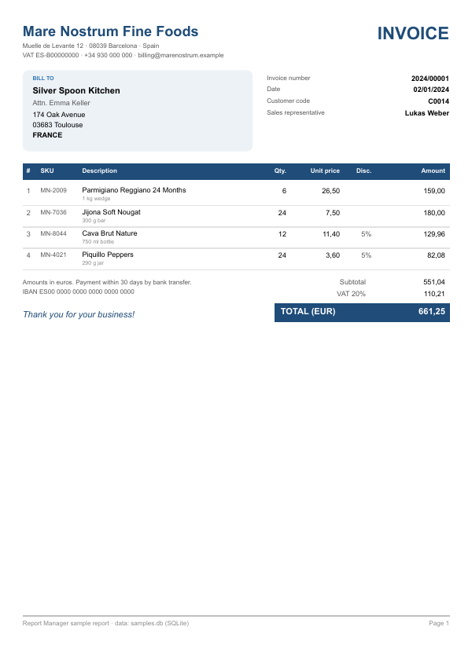
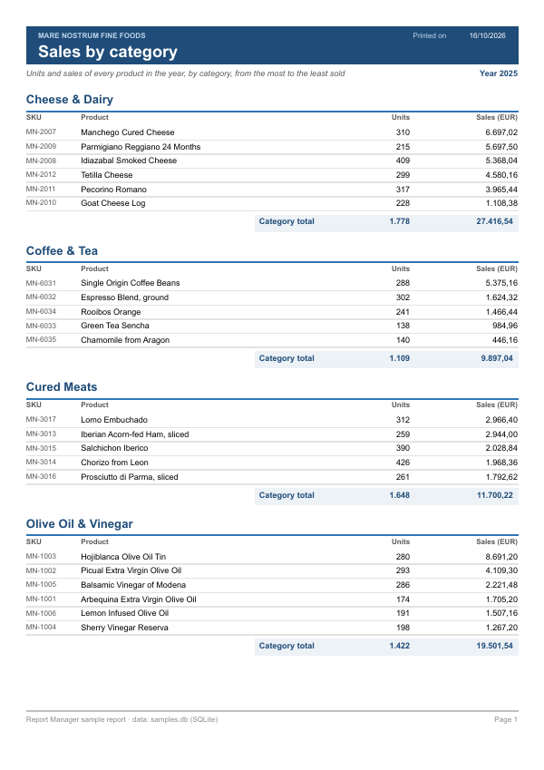
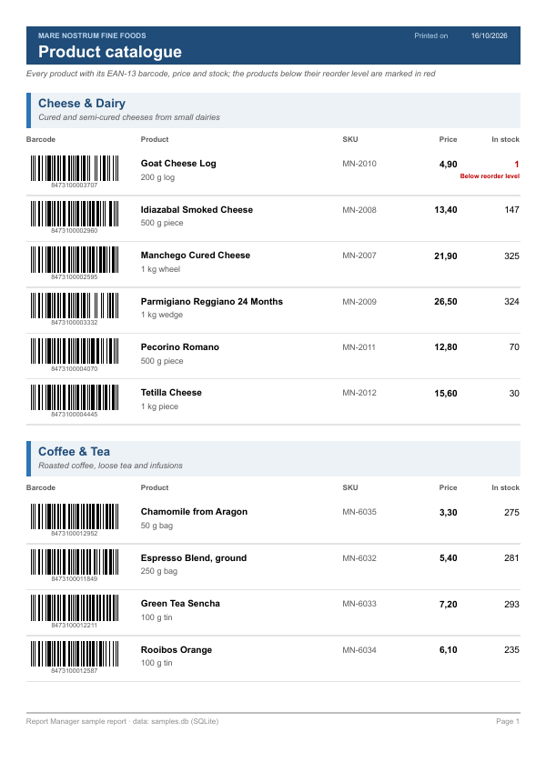
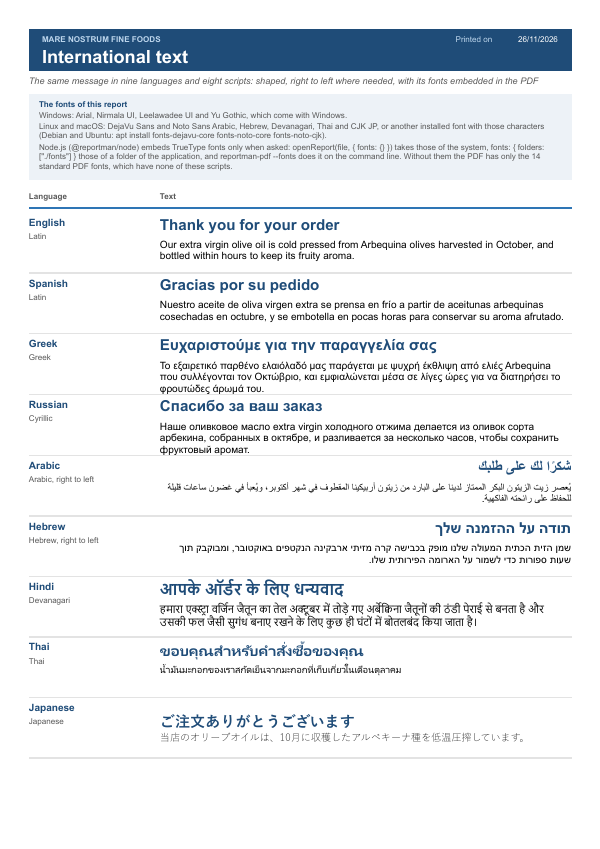

# @reportman/node

Run Report Manager `.rep` reports from Node.js to PDF, with JavaScript only: no native modules,
no WebAssembly, no external binaries. The report is laid out by `@reportman/engine`, a translation
of the C# engine, and gives the same PDF.

Status: preview (`4.1.0-alpha.N`, npm tag `next`): the API may change until 4.1.0. Supported
today: labels, expressions, shapes, images (JPEG, PNG, BMP, GIF), barcodes (1D, PDF417, QR),
charts, sections and groups, subreports, master/detail, parameters, the standard 14 PDF fonts
and, with the `fonts` option, embedded TrueType and OpenType fonts with HTML text, right to left
and complex scripts, and PDF/A-3B.

## Examples

<p>
<a href="https://github.com/tonimartir/reportman/tree/main/typescript/examples"></a>
<a href="https://github.com/tonimartir/reportman/tree/main/typescript/examples"></a>
<a href="https://github.com/tonimartir/reportman/tree/main/typescript/examples"></a>
<a href="https://github.com/tonimartir/reportman/tree/main/typescript/examples"></a>
</p>

Eleven sample reports (invoices, groups and totals, charts, EAN-13 barcodes, labels, HTML text,
unions of datasets, nine languages in eight scripts) with their `.rep` files and the PDFs this
package makes of them: the [examples gallery](https://github.com/tonimartir/reportman/tree/main/typescript/examples),
which also shows how to run them from the command line and from a program. To see them run, the
[live demo](https://reportman.es/demo/) runs them in your browser with nothing installed
(parameters, preview and PDF), and on your computer:

```bash
npx @reportman/server --samples     # the samples in a web console at http://127.0.0.1:8080/
```

## Install

```bash
npm install @reportman/node@next
npm install @reportman/driver-postgres@next   # or driver-firebird, driver-mysql, driver-mssql, driver-http
npm install @reportman/dfm@next               # only for reports saved by Delphi in a DFM form
```

Reports saved as XML need no `@reportman/dfm` (see [Command line](#command-line)).

Node 22.12 or later. The packages are ES modules only; a CommonJS program loads them with
`require('@reportman/node')` (Node's `require(esm)`).

## Fonts

A report that only prints Latin text with the standard fonts needs nothing. HTML text, right to
left text, other scripts (Greek, Cyrillic, Arabic, Hebrew, Devanagari, Thai, Japanese...),
embedded TrueType fonts and PDF/A-3 need the TrueType fonts of the machine, which the engine
embeds only when it is given them:

```ts
const report = await openReport('letter.rep', {
  connections: { SAMPLES: sqlite('samples.db') },
  fonts: {},                                    // the font folders of the system
  // fonts: { folders: ['./fonts'] },           // a folder of the application first, then the system ones
  // fonts: { folders: ['./fonts'], systemFolders: false },   // only that folder: the same PDF everywhere
});
```

On the command line: `npx reportman-pdf letter.rep --fonts` (or `--font-folder ./fonts`). The
folders are scanned once per process.

- Without `fonts` (or `fonts: false`) the PDF uses the standard 14 PDF fonts, as the C# device
  `PrintOutPDFStandard`: they have only the characters of Windows-1252, so the others print as
  `?` or as a similar Latin letter (Greek α as a), and HTML text, right to left text and PDF/A-3
  fail with an error that says to give fonts.
- With `fonts` the PDF is the one of the C# FreeType device (`PrintOutPDFFreeType`): each font is
  chosen by the report's font name and style (`WFontName` on Windows, `LFontName` elsewhere, or
  `platform`), a character the font lacks takes a font that has it, every text is shaped
  (ligatures, kerning, marks, Arabic, Hebrew, Devanagari, Thai) and laid out with the Unicode
  bidirectional algorithm, and the fonts are embedded as subsets. A `FontLibrary` of
  `@reportman/text` can be given instead, for fonts that are not files on the disk.
- The fonts are read with fontkit: TrueType, OpenType CFF and collections. Type 1 fonts (`.pfb`)
  are not read, and a CFF2 (variable OpenType) font fails with a clear error.

### On each system

A report names a font for Windows (`WFontName`) and one for Linux and macOS (`LFontName`). The
engine takes the one of the system it runs on, and a character that font lacks takes another font
of the folders that has it. So the PDF depends on the fonts installed:

| System | Folders of `fonts: {}` | What to install |
|---|---|---|
| Windows | `%WINDIR%\Fonts` and `%LOCALAPPDATA%\Microsoft\Windows\Fonts` | Nothing for the usual scripts: Arial, Nirmala UI (Devanagari), Leelawadee UI (Thai) and Yu Gothic (Japanese) come with Windows. |
| Linux | The `<dir>` folders of `/etc/fonts/fonts.conf`, `/usr/share/fonts` and `/usr/local/share/fonts` | The families the reports name, or others with the same characters. Debian and Ubuntu: `apt install fonts-dejavu-core fonts-liberation fonts-noto-core fonts-noto-cjk` (Liberation Sans has the metrics of Arial; `fonts-noto-cjk`, for Chinese, Japanese and Korean, is large). Other distributions: their DejaVu, Liberation and Noto packages. |
| macOS | `/Library/Fonts`, `~/Library/Fonts` and `/System/Library/Fonts` | Helvetica, Arial and fonts for the other scripts come with macOS, and the engine takes them for the characters the named family lacks. Install the families the reports name (DejaVu, Noto) for the PDF of Linux. |

The slim Docker images of Node.js (`node:22-slim`, `node:22-alpine`) have no fonts at all, and
there a report run with `fonts: {}` fails with `No fonts detected`:

```dockerfile
FROM node:22-slim
RUN apt-get update && apt-get install -y --no-install-recommends \
      fonts-dejavu-core fonts-liberation fonts-noto-core fonts-noto-cjk \
    && rm -rf /var/lib/apt/lists/*
```

For the same PDF on every machine, with nothing installed, put the font files (`.ttf`, `.otf`,
`.ttc`, `.woff`, `.woff2`) in a folder of the application and give only that folder:
`fonts: { folders: [path.join(__dirname, 'fonts')], systemFolders: false }`. The fonts of Windows
are licensed with Windows: elsewhere, use free fonts such as Liberation Sans (for Arial), DejaVu
and Noto, which allow embedding.

The sample `international.rep` (nine languages, eight scripts) prints this at its top: the fonts it
uses on each system and how to give them.

## The two steps

```ts
import { openReport, sqlite } from '@reportman/node';

const report = await openReport('invoices.rep', {
  connections: { SAMPLES: sqlite('samples.db') },   // by report connection alias
  culture: 'pt-BR',
});

// Step 1: the parameters, with list options and lookups resolved (the JSON of the .NET server)
const parameters = await report.describeParameters();

// Step 2: the values the user gave → the PDF
const pdf = await report.executeToPdf({ FIRST_ORDER: 7, LAST_ORDER: 9 });
```

- A wrong value throws a `ParameterException` naming the parameter and the problem
  (`Unknown`, `NotEditable`, `Required`, `WrongType`, `NotAnOption`, `Validation`).
- A report with nothing to print throws `NoDataToPrintException`.
- `renderParametersForm(parameters)` draws a plain HTML form as a reference; a host usually draws
  its own from the same JSON.
- `beforeRun(model)`, an option of `openReport`, adjusts the fresh copy of the report each step
  runs, as an old host did before running it: the language (`model.language = 4`) or the value
  of a hidden parameter (`CODEMP`), which `executeToPdf` does not take from the caller.
- `executeToPdf(values, { signal, onProgress })` (and `executeToMetafile`): an `AbortSignal`
  cancels the run, which then fails with the reason of the signal; `onProgress(records, pages)`
  is called at most every half second and at the end. A query already sent to the database runs
  to its end.
- A report that reads data while it prints (GETVALUEFROMSQL, a dataset opened on demand) needs a
  driver with `synchronous: true`. With an asynchronous one it fails, and
  `isSynchronousDataRequired(error)` tells it apart, so a host can run it again synchronously.

## Data

- `connections`: a factory per report connection alias. Only these are opened, whatever the
  `.rep` carries inside. `sqlite(file)` uses Node's built-in `node:sqlite` with the behaviour of
  Microsoft.Data.Sqlite, the provider of the C# engine. A factory receives the connection request
  (alias, driver, connection string, parameters) and returns `{ query(command), close(commit) }`.
  A MyBase connection (in-memory datasets: unions of other datasets of the report) opens nothing
  and needs no factory.
- `datasets`: rows for a dataset instead of running its SQL — `{ columns, rows }` or a function,
  for example the result of a REST API.
- `dbxConnections({ drivers, password })`: the connections of this computer in the shared
  `dbxconnections.ini` (the `DriverName=ADO.NET` sections Reportman.Server and the designers
  write), by alias, to pass as `connections`. SQLite is built in; the other databases take the
  driver function of their package (`drivers: { postgresql: postgres, firebird, mysql, sqlserver:
  mssql }`). A password the file keeps ciphered with Windows DPAPI cannot be read from JavaScript:
  `password(alias, name)` gives it (an environment variable, a secret store).

```ts
import { dbxConnections, openReport } from '@reportman/node';
import { postgres } from '@reportman/driver-postgres';

const connections = dbxConnections({
  drivers: { postgresql: postgres },
  password: (alias) => process.env[`REPORTMAN_PASSWORD_${alias}`],
});
const report = await openReport('sales.rep', { connections });
```

## Command line

```bash
reportman-pdf invoices.rep -o invoices.pdf --sqlite SAMPLES=samples.db -paramFIRST_ORDER=7
reportman-pdf invoices.rep --describe --sqlite SAMPLES=samples.db
```

Reports are XML (plain or zlib compressed). A report saved by Delphi in a DFM form (text, binary or
compressed) opens too when the optional package `@reportman/dfm` is installed: `openReport`
converts it to the XML the Delphi engine writes for it (`dfm: false` refuses it instead). Without
that package it can be saved again as XML from the Report Manager designer, or converted with
`npx @reportman/dfm` or the `reptotxt -xml` command of Report Manager.
