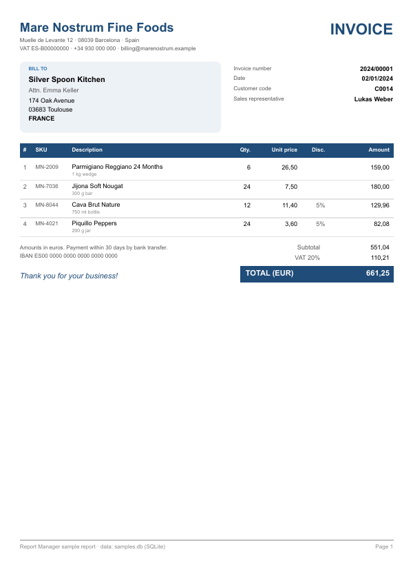
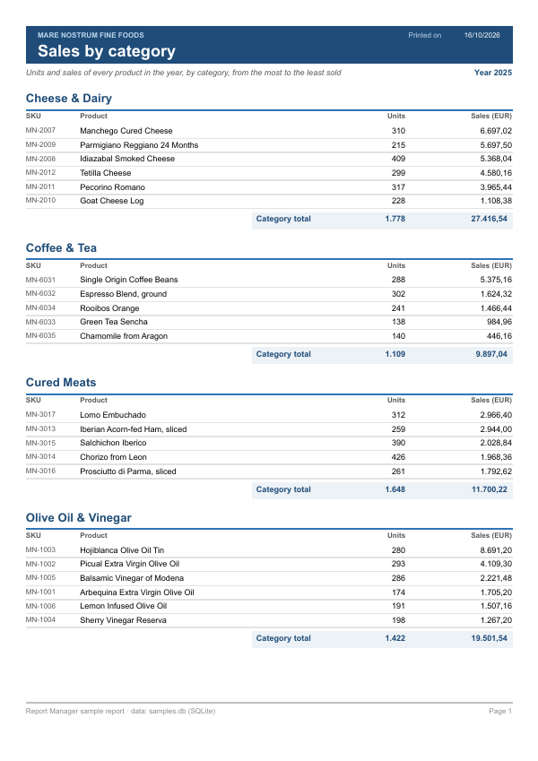
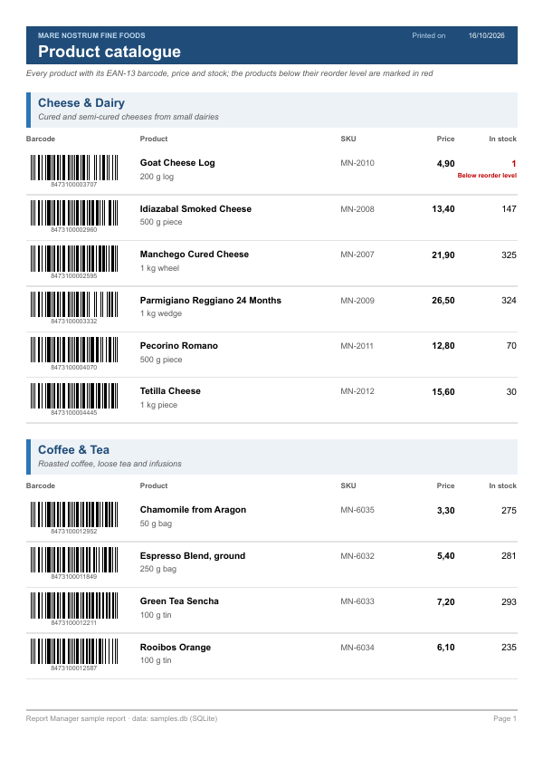
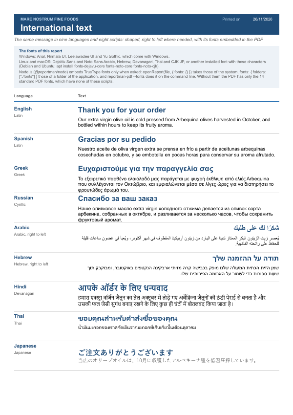

# @reportman/pdf

The PDF output of Report Manager: it writes the pages of a metafile as a PDF — with the standard
14 PDF fonts or embedded subsets of TrueType and OpenType fonts, images, and PDF/A-3B — and it is
the layout device the engine measures text through while a report is laid out, so the text breaks
in lines exactly as it is drawn.

To run reports to PDF, see [`@reportman/node`](https://www.npmjs.com/package/@reportman/node); the
metafile comes from [`@reportman/engine`](https://www.npmjs.com/package/@reportman/engine) or from a
`.rpmf` file read with [`@reportman/metafile`](https://www.npmjs.com/package/@reportman/metafile).

Status: preview (`4.1.0-alpha.N`): the API may change until 4.1.0. Browser and Node.

## Examples

Eleven sample reports, with pictures of their pages, their `.rep` files and the PDFs this package
writes for them, are in the
[examples gallery](https://github.com/tonimartir/reportman/tree/main/typescript/examples). To see
them run: `npx @reportman/server --samples`.

## The packages

The PDF output and the packages around it are described in the
[TypeScript README](https://github.com/tonimartir/reportman/tree/main/typescript) of the repository.
